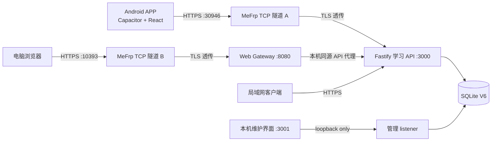

# 理论考试练习系统


> 本图为 AI 生成的氛围插画，不是应用截图。真实界面请查看 `design/reference/` 与本项目的浏览器验收截图。

这是一个运行在个人 Linux 主机上的理论考试学习系统：Android 客户端和电脑网页共用一套 Fastify API 与本机 SQLite 数据库。它面向个人或小范围受邀用户，不是公开注册的 SaaS，也不依赖云数据库。

**项目状态：** P0–P5-A 已验收；P5-B 的服务器部署、HTTPS、V6 数据库、正式题库和 Android dev.10 登录练习已运行。本轮 Web 缺陷修复已经部署；公网严格 HTTPS 浏览器完成 16 路由 × 6 视口检查，隔离 SQLite/真实题库完成核心业务浏览器流程。P5-B 总体验收仍按路线图跟踪。P6 正式签名、发布 QA 和完整更新链尚未开始。

## Android 测试包

[下载 Android dev.10 测试 APK](https://github.com/MilchstraBe-Endless10/theory-exam/releases/download/v1.0.0-dev.10-test/theory-exam-mobile-dev.10.apk) · [GitHub 测试预发布说明](https://github.com/MilchstraBe-Endless10/theory-exam/releases/tag/v1.0.0-dev.10-test)

| 项目 | 值 |
|---|---|
| 包名 | `com.theoryexam.mobile.dev` |
| 应用版本 | `1.0.0-dev.10`（versionCode 10） |
| SHA-256 | `5d0089f664c63d52ade066679b38320c12b418de54613c716dd19a443e78ebb2` |
| 签名 | Android Debug 测试签名；不是正式生产签名 |
| API 地址 | `https://118.24.61.190:30946` |
| Web 地址 | `https://118.24.61.190:10393` |

APK 只面向该私有 GitHub 仓库的获准协作者下载。包内包含用于当前 IP HTTPS 服务的**公开 CA 证书**；服务端 CA/叶证书私钥没有打入 APK。Android 网络安全配置将可信 CA 限定到当前 API IP，仍要求 HTTPS、证书链和 IP SAN 正确验证，并禁止明文流量。服务器或 CA 轮换时，客户端信任配置也需要按计划更新。

安装后可在 APP 的连接页扫码或手动输入 API 地址，然后用维护者发放的普通账号登录。不要在公开渠道转发测试包或测试凭据。电脑浏览器使用 Web 地址时，需在该电脑上信任 Web 私有 CA；浏览器不会继承 Android APK 的 CA 信任。**不要忽略浏览器证书警告。**

## 功能

- 管理员在本机创建账号并导入 Excel 题库；没有公开注册入口。
- 顺序、随机、题型、未做、收藏和错题练习，答题结果由服务端判定。
- 模拟考试固定使用服务器组卷、计时、答案同步和交卷评分；四级规则为 180 题、100 分、90 分钟。
- 错题按不同复习轮次推进状态；不同轮次连续两次答对后成为已掌握。
- 收藏、练习进度、考试成绩、错题和复习历史按账号隔离并持久化。
- Web 端经同源 HTTPS Gateway 访问业务 API；Android 使用 Capacitor 原生能力及安全存储。

## 系统结构


> 本图为概念插画；准确的服务边界与请求流见 [项目架构与开发指南](docs/PROJECT_GUIDE.md#系统架构)。



管理 listener `127.0.0.1:3001` 不通过 MeFrp 隧道对外提供。MeFrp 使用 TCP 透明转发，业务 TLS 在本机服务端终止；两个公网端口都不是明文 HTTP 代理。正式环境不使用域名，公网以 IP 和分配端口访问。

## 技术栈与目录

| 路径 | 职责 |
|---|---|
| `apps/mobile/` | React、TypeScript、Vite 客户端；同一 UI 用于桌面 Web 与 Capacitor Android |
| `apps/mobile/src/services/` | API 请求、会话、网络和客户端状态 |
| `apps/mobile/src/pages/`、`components/`、`styles/` | 页面、共享 UI 和视觉样式 |
| `apps/mobile/android/` | Capacitor Android 壳、原生插件、网络安全配置 |
| `apps/server/src/` | Fastify 服务、鉴权、业务路由、SQLite、TLS listener 和 Web Gateway |
| `apps/server/test/`、`scripts/` | 单元/集成测试和真实 Chromium 浏览器流程 |
| `docs/` | PRD、架构、API、运维、路线图和项目指南 |
| `design/reference/` | 已确认的桌面与移动视觉参考；不是动态业务数据 |
| `local-input/` | 本机测试题库等输入，Git 忽略，不提交 |

详细数据流、账号安全、考试状态机、迁移和开发阶段见 [docs/PROJECT_GUIDE.md](docs/PROJECT_GUIDE.md)。

## 本机开发

需要 Node.js 24 或更新版本。前端与服务端依赖分别安装：

```bash
npm --prefix apps/mobile install
npm --prefix apps/server install
npm --prefix apps/mobile run dev
npm --prefix apps/server run dev
```

服务端默认绑定 loopback，SQLite 位于用户数据目录。浏览器本机开发通过 Vite API 代理访问测试 API；生产服务要使用受信任 TLS 证书。不要把正式数据库、CA 私钥、MeFrp Token、账号资料或 `.env` 文件复制到仓库。

主要验证命令：

```bash
npm --prefix apps/mobile run typecheck
npm --prefix apps/mobile run build
npm --prefix apps/mobile run test
npm --prefix apps/server run typecheck
npm --prefix apps/server run build
npm --prefix apps/server test
npm --prefix apps/server run test:browser
npm --prefix apps/server run test:web:browser
```

Android 构建还需要 JDK 21 与 Android SDK。普通开发 APK 的 CA 构建输入来自仓库外的 `THEORY_API_CA_FILE` 公共证书路径；不提交该证书，也不提交它的私钥。构建说明见 `docs/PROJECT_GUIDE.md`。

## 版本与阶段

开发 APK 的 `dev.N` 是迭代构建编号，不等同于每个阶段都发布过的稳定版本。可核实的改动、遗留缺陷和缺失归档记录列在 [CHANGELOG.md](CHANGELOG.md)。未来版本应递增 `versionCode`，并附源码 SHA、APK SHA-256、签名身份、修复清单和升级验证结果。

| 阶段 | 状态 |
|---|---|
| P0、P0-M | 项目骨架、桌面基准与手机 12 屏视觉完成 |
| P1–P4 | 账号/题库、练习、考试、错题复习完成 |
| P5-A | Android 原生、安全隔离、会话、备份和更新校验验收完成 |
| P5-B | 实际部署与 Android 学习通过；本轮 Web 修复已部署并完成公网路由/视口复验，核心业务流程在隔离真实 API 上通过 |
| P6 | 正式发布签名、升级链与发布前 QA，未开始 |

## 安全与隐私

本仓库为私有仓库。原始 Excel、生产数据库及其备份、证书私钥、MeFrp Token、账号凭据、原始 Logcat 与构建 APK 都不应提交。普通用户没有管理权限；Web Gateway 的业务路由白名单不代理管理 API；考试正确答案由服务器在交卷前隐藏。安全决策与已知限制见 [架构指南](docs/PROJECT_GUIDE.md#安全边界) 和 [路线图](docs/ROADMAP.md)。
