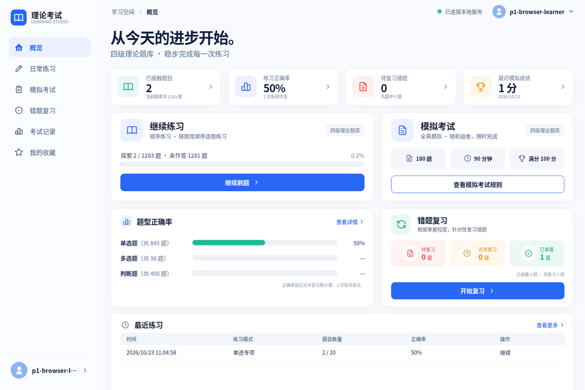
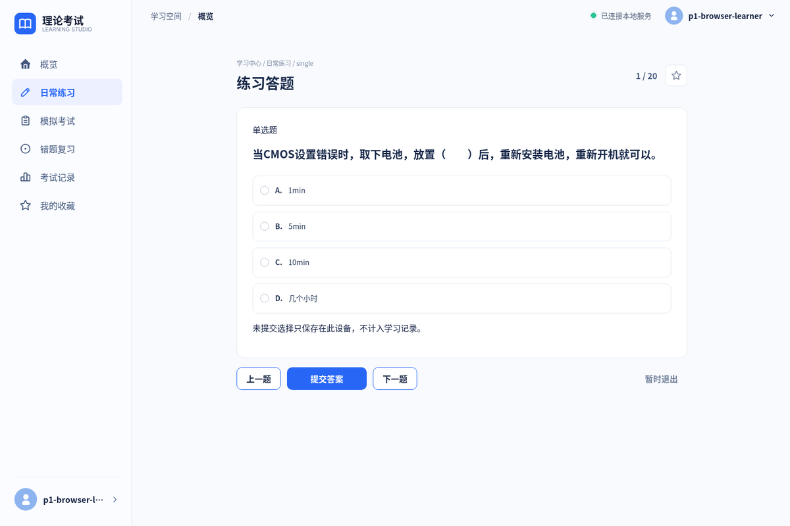
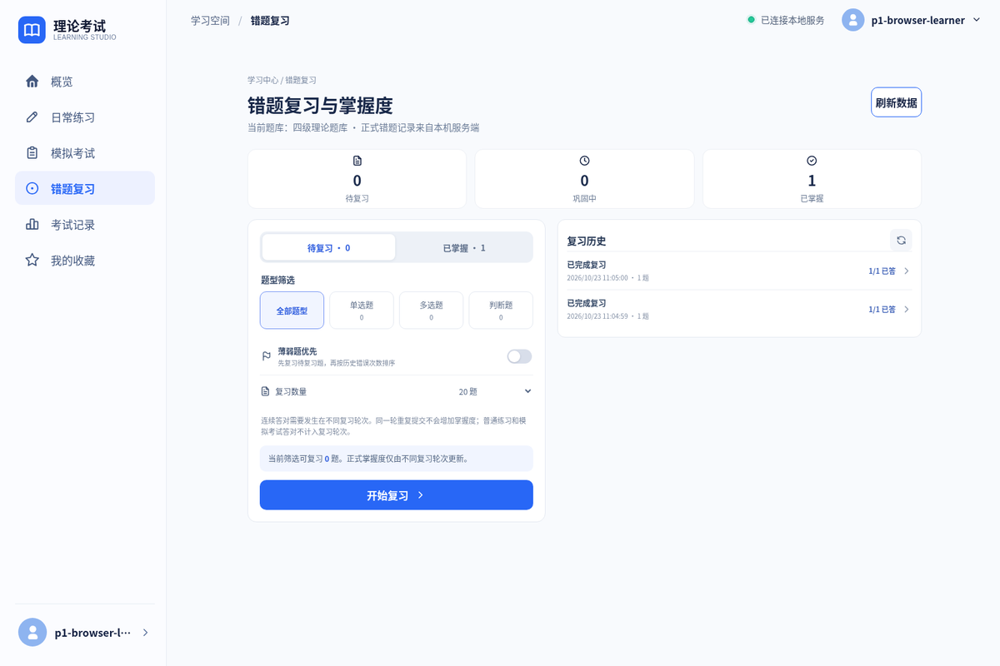
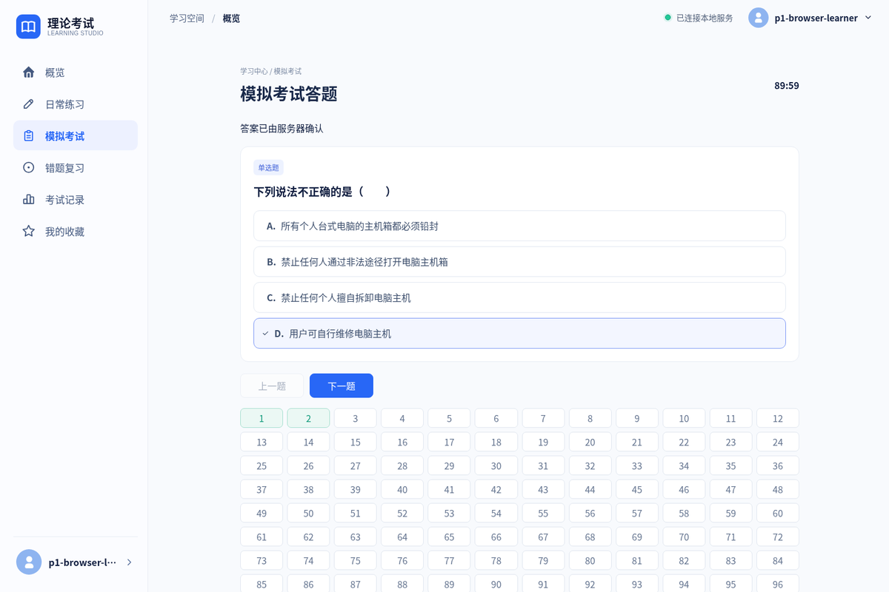
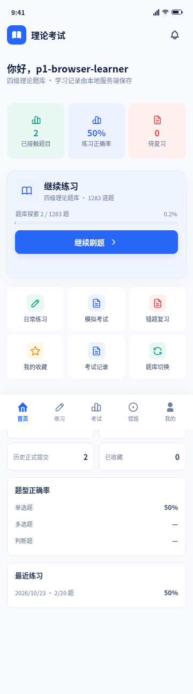
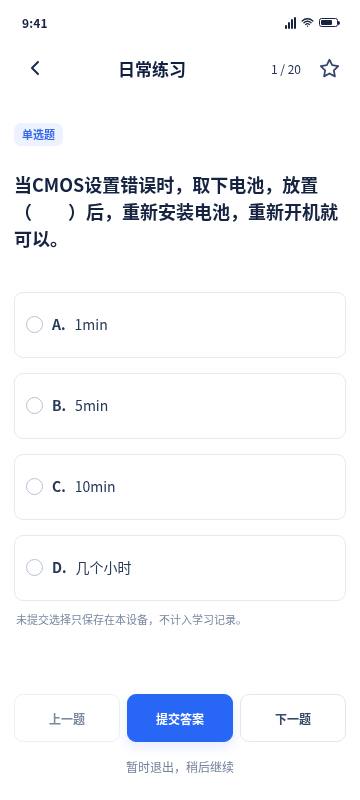
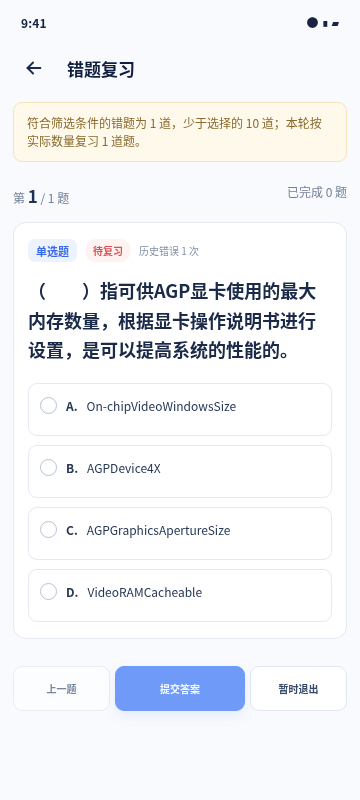
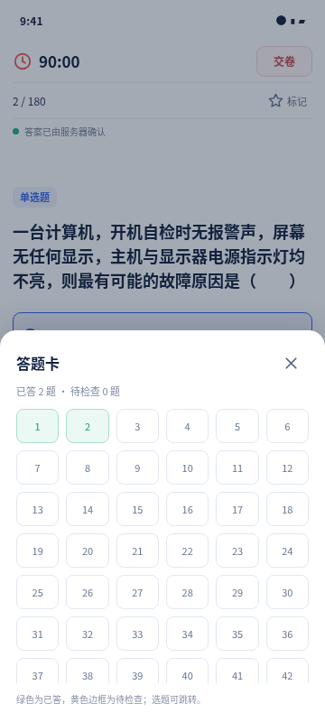

# 理论考试练习系统

一套**完全自托管**的理论考试学习系统：Android 客户端与电脑网页共用一套 Fastify API 和本机 SQLite。面向个人或小范围受邀用户，没有公开注册，不依赖云数据库、云认证或任何第三方 SaaS。

**项目状态：** P0–P5-A 已验收；P5-B 的服务器部署、HTTPS、V6 数据库、正式题库和 Android dev.10 已实际运行。P5-B 仍有三项运维收尾阻塞（见 [未完成事项与已知限制](#未完成事项与已知限制)）。P6 正式签名、发布 QA 与完整升级链尚未开始。

---

## 界面

> 以下为**真实运行界面截图**，来自 2026-10-23 的 P5-B 隔离 SQLite + 真实 1,283 题题库验收（production Web Gateway 构建，严格 CA 校验）。不是设计稿，也不是拿参考图当背景。

### 电脑网页端

| 学习概览 | 日常练习 |
|---|---|
|  |  |

| 错题复习与掌握度 | 模拟考试答题 |
|---|---|
|  |  |

### Android / 移动端

| 首页 | 练习答题 |
|---|---|
|  |  |

| 错题复习 | 考试答题卡 |
|---|---|
|  |  |

同一套 React 页面同时服务桌面 Web 与 Capacitor Android（响应式，非两套代码）。设计基准图在 `design/reference/`：桌面 `dashboard-desktop-v1.png`（1536×1024）、手机 12 屏 `mobile-12-screens-v1.png`。

### 氛围插画（非截图）


> 上图为 AI 生成的氛围插画，仅作仓库封面；真实界面见上方截图与 `design/reference/`。

---

## 目录

- [界面](#界面)
- [功能](#功能)
- [技术栈](#技术栈)
- [系统架构](#系统架构)
- [数据模型与迁移](#数据模型与迁移)
- [安全边界](#安全边界)
- [Android 客户端](#android-客户端)
- [生产 APK 的 CA 构建输入](#生产-apk-的-ca-构建输入)
- [本机开发与验证](#本机开发与验证)
- [部署](#部署)
- [版本与阶段](#版本与阶段)
- [未完成事项与已知限制](#未完成事项与已知限制)
- [文档索引](#文档索引)

---

## 功能

- **账号**：仅由本机维护者在管理入口创建，没有注册入口。Argon2id 加盐哈希；首次登录强制改密；改密/停用/重置即撤销旧会话。不同用户的数据完全隔离。
- **题库**：从本机 Excel 两阶段导入（预览 → 确认），带题库版本号。当前正式题库 1,283 题（845 单选、38 多选、400 判断）。
- **日常练习**：顺序、随机、题型、未做、收藏、错题六种模式；答题由服务端判分；会话与顺序持久化，可退出后续做。
- **收藏**：服务端账号数据，支持收藏列表与收藏专项练习。
- **模拟考试**：四级固定规则 **120 单选×0.5 + 20 多选×1 + 40 判断×0.5 = 180 题 / 100 分 / 90 分钟**。组卷时固定题目与选项快照；服务器裁定开始、截止、同步与评分；答案修改带逐题版本与幂等请求号，防旧请求覆盖；交卷与超时结算幂等；交卷前不返回标准答案。
- **错题复习**：普通练习或考试答错进入错题；复习以独立轮次推进，**不同轮次连续两次答对**才升为已掌握（`待复习 → 巩固中 → 已掌握`）；同一轮次重复提交不重复计数；支持题型/状态/数量组合与薄弱优先；历史轮次保留原题库版本快照。
- **学习分析**：题型正确率、进度、最近练习、成绩历史，全部来自服务端真实数据。
- **应用更新**：服务端校验 APK 缓存 SHA-256 后提供下载，客户端校验摘要、包身份与更高 `versionCode`。

## 技术栈

| 层 | 选型 |
|---|---|
| 客户端 | React 19、TypeScript 5.9、Vite 7、React Router 7、`@tabler/icons-react` |
| Android | Capacitor 8（core/app/network/status-bar/filesystem/secure-storage/file-opener/barcode-scanning）、AGP 8.13、Gradle 8.14.3、`minSdk 24` / `targetSdk 36` / `compileSdk 36` |
| 服务端 | Node.js ≥ 24、Fastify 5、`@fastify/multipart` / `rate-limit` / `static`、`@node-rs/argon2`（Argon2id）、exceljs |
| 数据 | SQLite（`node:sqlite`），6 个版本化迁移，`VACUUM INTO` 一致性备份 |
| 传输 | 纯 IP HTTPS + 独立私有 CA（API CA / Web CA 分离），IP SAN 校验，禁用明文回退 |
| 隧道 | 用户现有 MeFrp 两条 TCP 透明隧道（不终止业务 TLS），本机终止 |
| 运维 | systemd user units（含 Linger）、每日跨盘一致性备份与证书到期检查 timer |
| 测试 | `node:test` + tsx、真实 Chromium（CDP）端到端、Playwright 驱动的 UI smoke |

## 系统架构

```
┌────────────────────── 客户端 ──────────────────────┐
│  Android APP (Capacitor WebView)   电脑浏览器 (SPA) │
│  Bearer + Android SecureStorage    HttpOnly Cookie  │
└──────────┬──────────────────────────────┬───────────┘
           │ HTTPS (IP SAN)               │ HTTPS (IP SAN)
           ▼                              ▼
   MeFrp TCP 隧道 A                 MeFrp TCP 隧道 B
     <PUBLIC_API_PORT>               <PUBLIC_WEB_PORT>
           │ TCP 透传（不终止 TLS）          │
           ▼                              ▼
   Fastify 学习 API                Web Gateway :8080
   127.0.0.1:3000                         │
   LAN <LAN_IP>:3000 ─────────────┐       │ 同源白名单 /api/* 代理
           │                       │       ▼
           └───────────────────────┴──► Fastify 学习 API
                                           │
                                    ┌──────┴──────┐
                                    ▼             ▼
                              SQLite V6      管理 listener
                                             127.0.0.1:3001（loopback only，不入隧道）
```

关键设计：

- **单机单体**。一个 Fastify 流程同时提供业务 API 与本机管理 listener（不同端口、不同路由守卫）；不引入微服务、Redis、Kafka、云认证。
- **学习面与管理面彻底分离**。管理路由只接受 loopback peer；Web Gateway 用白名单代理 `/api/*`，明确拒绝 `/admin`、`/api/admin/*`、bootstrap 和未知路由 —— 不依赖 CORS、`X-Forwarded-For` 或隐藏导航。
- **网关不信任转发头**。剥除 `Forwarded`、`X-Forwarded-*`、`X-Real-IP`，Fastify `trustProxy=false`；身份永远取自服务端会话。
- **Web 用 Cookie，Android 用 Bearer**。浏览器侧 `HttpOnly; Secure; SameSite=Strict` Cookie + CSRF token，永不把 Bearer 放进 Web Storage；Android 走原生 SecureStorage。
- **证书按用途拆分**。API 与 Web 各一套私有 CA，互不共享；客户端只装公开 CA 证书，服务端私钥永不出仓库。
- **考试状态机在服务端**。`CREATED → IN_PROGRESS → SUBMITTED / EXPIRED / VOIDED`，截止时间由服务器裁定，客户端只做乐观显示。

请求流与逐路由契约见 [docs/API.md](docs/API.md)、[docs/ARCHITECTURE.md](docs/ARCHITECTURE.md)、[docs/PROJECT_GUIDE.md](docs/PROJECT_GUIDE.md)。

## 数据模型与迁移

| 迁移 | 内容 |
|---|---|
| V1 | 用户、会话、题库、导入任务、学习关联表 |
| V2 | 持久化练习会话与作答关联 |
| V3 | 账号测试标记与首次强制改密 |
| V4 | 考试答案逐题版本、不可变成绩明细 |
| V5 | 错题复习轮次与掌握度历史 |
| V6 | 会话 CSRF token 与 `remember` 续期策略 |

迁移只前进、不改写历史版本。`db:status` 用只读连接检查，不创建目录/库、不写 `user_version`；`db:migrate` 是独立显式路径，升级前必须先经 `VACUUM INTO` 建立并校验备份。

核心表：`users`、`sessions`、`question_banks`、`bank_versions`、`questions`、`exam_rules`、`exam_sessions`、`exam_question_snapshots`、`exam_answers`、`exam_results`、`practice_sessions`、`practice_session_questions`、`practice_attempts`、`favorites`、`review_rounds`、`review_round_questions`、`review_attempts`、`mistake_states`、`import_jobs`。

## 安全边界

- 生产 API 与 Web 全部 HTTPS + IP SAN；不含域名，不做明文回退。
- Android 包内只有 **CA 公开证书**；`usesCleartextTraffic=false`，`network_security_config` 只对明确的 IP（公网 API、当前 LAN IP）信任该私有 CA。该配置与信任主机清单同样**在构建期从仓库外注入**，仓库内只保留不信任任何主机的安全默认值。
- 浏览器 Web CA 与 Android API CA 分开管理；每个访问 Web 的电脑需单独信任 Web CA。**禁止**"忽略证书错误"、trust-all、关闭主机名/IP 校验。
- 登录限流；登录错误不区分"用户不存在/密码错/账号停用"；日志与响应不输出密码、哈希或 Token。
- Cookie 写请求校验 CSRF token 与 Origin；同 IP 不同端口不做 Cookie 混淆。
- 更新链路校验 SHA-256 + 包身份 + 递增 `versionCode`；Debug 包不得冒充正式签名版本。
- 仓库**忽略**：`local-input/`（含原始 Excel）、SQLite 与备份、`.env*`、证书与私钥、`frpc*` 配置与 Token、`keystore.properties`、`*.jks`、`*.keystore`、日志、`artifacts/`。

完整清单与威胁模型见 [docs/PROJECT_GUIDE.md](docs/PROJECT_GUIDE.md)、[docs/OPERATIONS-P5.md](docs/OPERATIONS-P5.md)。

## Android 客户端

| 项目 | 值 |
|---|---|
| 包名（开发） | `com.theoryexam.mobile.dev` |
| 当前测试包 | `1.0.0-dev.10`（versionCode 10），Android Debug 签名 |
| 应用名 | 理论考试练习（开发版） |
| 最低 / 目标 SDK | 24 / 36 |

原生能力：二维码扫码（CameraX + ML Kit 实时流）、网络状态、状态栏、安全存储、文件打开器（APK 安装）、应用生命周期。

[下载 dev.10 测试 APK](https://github.com/MilchstraBe-Endless10/theory-exam/releases/download/v1.0.0-dev.10-test/theory-exam-mobile-dev.10.apk) · [测试预发布说明](https://github.com/MilchstraBe-Endless10/theory-exam/releases/tag/v1.0.0-dev.10-test)

| 项目 | 值 |
|---|---|
| SHA-256 | `5d0089f664c63d52ade066679b38320c12b418de54613c716dd19a443e78ebb2` |
| API 地址 | `https://<PUBLIC_HOST>:<PUBLIC_API_PORT>` |
| Web 地址 | `https://<PUBLIC_HOST>:<PUBLIC_WEB_PORT>` |

> 这是 Debug 签名测试包，**不是正式发行版**。升级连续性、正式签名与正式 Release 属 P6。

## 生产 APK 的 CA 构建输入

这是"生产 APK 可复现且安全"的关键机制：

1. **CA 公开证书不进仓库**。构建从仓库外路径读取：`THEORY_API_CA_FILE`。
2. **未指定时的默认路径**：`~/.local/share/theory-exam/pki/p5b-20261022/api-ca.pem`（本机部署目录，仓库外）。
3. **Gradle 任务 `prepareApiCaResource`** 把它复制到被 Git 忽略的 `apps/mobile/android/app/src/main/res/raw/`；若资源已存在且字节不一致，**构建直接失败并保留原文件**，不静默覆盖。
4. **私钥绝不参与构建**。`api-ca.key`、`api-server.key`、`web-ca.key`、`web-server.key` 均在仓库外 0600 目录。

```bash
THEORY_API_CA_FILE=/absolute/path/to/api-ca.pem \
  npm --prefix apps/mobile run android:debug
```

可复现性约束：

- CA 证书的**指纹**应随 APK 一起记录（构建清单），用于核对 APK 内置信任锚与部署证书一致。
- 服务端或 CA 轮换 → 必须重新签发叶证书，并发布包含新 CA 的递增 `versionCode` APK；旧 CA 只在新链验证通过后移除。
- 测试 CA 与生产 API CA 用途不同，**不可互换**。

详见 [docs/PROJECT_GUIDE.md](docs/PROJECT_GUIDE.md)。

## 本机开发与验证

需要 **Node.js ≥ 24**；Android 构建另需 **JDK 21** 与 **Android SDK（platform 36 + build-tools 36）**。

```bash
npm --prefix apps/mobile install
npm --prefix apps/server install

npm --prefix apps/mobile run dev     # Vite 开发服务器
npm --prefix apps/server run dev     # Fastify 学习 API
```

服务端默认绑定 loopback（`127.0.0.1:3000`，管理 `127.0.0.1:3001`），SQLite 位于用户数据目录。

### 验证命令

```bash
# 服务端
npm --prefix apps/server run typecheck
npm --prefix apps/server run build
npm --prefix apps/server test                  # 62 项 node:test
npm --prefix apps/server run test:browser      # 12 步真实 Chromium 业务流
npm --prefix apps/server run test:web:browser  # 生产 Gateway 16 路由 × 6 视口

# 客户端
npm --prefix apps/mobile run typecheck
npm --prefix apps/mobile run build
npm --prefix apps/mobile run test              # 20 项 UI smoke + 6 项会话回归

# Android
npm --prefix apps/mobile run android:debug     # cap sync + gradlew assembleDebug
```

> `apps/server/test/exam.test.ts` 与 `review.test.ts` 需要仓库外 `local-input/四级理论试题.xlsx`（Git 忽略）。缺失时该用例会失败，这是预期的安全行为，不会伪造通过。

### 最近一次完整验证（2026-11-09，隔离 `git worktree` 干净检出）

| 项 | 结果 |
|---|---|
| 服务端 typecheck / build | 通过 |
| 服务端 `test` | **62 / 62 通过** |
| 服务端 `test:browser`（P1–P5 业务流） | **12 / 12 通过** |
| 服务端 `test:web:browser`（16 路由 × 6 视口） | **10 / 10 通过**，无未捕获异常 |
| 客户端 typecheck / build | 通过（6327 模块，gzip 主包 129.71 kB） |
| 客户端 `test` | **26 / 26 通过**（UI smoke 20 + 会话 6） |
| Android `:app:assembleDebug` | **BUILD SUCCESSFUL**，APK 36.1 MB，Debug 签名，含 `res/raw/theory_exam_api_ca.pem` |

## 部署

生产由三个 systemd user unit 常驻（模板见 `deploy/systemd/`）：

| Unit | 作用 |
|---|---|
| `theory-exam-p5b-api.service` | Fastify 学习 API（HTTPS，loopback + LAN listener） |
| `theory-exam-p5b-web-lan.service` | Web Gateway（LAN HTTPS） |
| `theory-exam-p5b-web-public.service` | Web Gateway（MeFrp loopback HTTPS） |
| `theory-exam-p5b-maintenance.timer` | 每日跨盘一致性备份 + 证书到期检查 |

Web Gateway 启动：

```bash
NODE_ENV=production \
WEB_HOST=127.0.0.1 WEB_PORT=8080 \
WEB_API_TARGET=http://127.0.0.1:3000 \
WEB_TLS_CERT_FILE=/absolute/path/outside-repository/fullchain.pem \
WEB_TLS_KEY_FILE=/absolute/path/outside-repository/privkey.pem \
npm --prefix apps/server run web:start
```

> 生产模式缺 TLS cert/key 会**启动失败**，不会退化为明文。Vite 5173 仅供开发。

运维手册（备份/恢复、证书轮换、回滚、排障）见 [docs/OPERATIONS-P5.md](docs/OPERATIONS-P5.md)。

> 本仓库文档中的 `<PUBLIC_HOST>`、`<PUBLIC_API_PORT>`、`<PUBLIC_WEB_PORT>`、`<LAN_IP>` 均为占位符，真实部署地址不写入公开文档。实际值只保存在维护者本机的受限部署配置中。

## 版本与阶段

| 阶段 | 状态 |
|---|---|
| P0 | 项目骨架、桌面首页视觉基准（1536×1024） |
| P0-M | 手机 12 屏视觉与交互 |
| P1 | 账号、SQLite、Excel 两阶段导入 |
| P2 | 日常练习、收藏、进度 |
| P2-R | 账号发放、首次强制改密、会话撤销与隔离 |
| P3 | 模拟考试（180/100/90 状态机） |
| P4 | 错题复习轮次、三态掌握、学习分析 |
| P5-A | Android 原生壳、安全隔离、会话/CSRF、备份与更新校验、生产 Web Gateway |
| P5-B | 真实部署与 Web 全站验收完成；**三项运维收尾仍阻塞** |
| P6 | 正式签名、升级链、发布 QA —— 未开始 |

`dev.N` 是内部构建序号，不等于发布版本。逐包证据与空缺见 [CHANGELOG.md](CHANGELOG.md)。

## 未完成事项与已知限制

诚实列出，不因代码合并而标记完成。

**P5-B 未闭环（3 项，运维性质，不阻塞构建与合并）**

1. LAN 地址（`<LAN_IP>`）仍是 DHCP 自动分配，未确认路由器的静态租约。地址变化需重新签发证书并更新 APK 网络策略。
2. `nftables` 的 LAN TCP 3000/8080 最小放行规则未应用（当前无 sudo 非交互权限读取有效 ruleset），也未从第二台 LAN 设备做过访问验收。本机自连健康**不能**替代 LAN 跨设备验证。
3. MeFrp 两个客户端进程仍以 `-t` argv 传递 token；官方单隧道配置只读导出接口对现有快捷启动凭据返回 HTTP 401，尚无可复现的安全迁移配置与回滚演练。token 值未进入仓库、文档或日志。

**P6 未开始**

- 正式签名身份与密钥保管、APK 升级安装连续性、完整发布 QA、正式 GitHub Release。
- dev.10 仅为 Debug 测试签名包。

**其他限制**

- 无域名、无 DDNS，公网走纯 IP + 端口；CA 轮换需要人工分发新 CA。
- 浏览器必须每台机器单独信任 Web CA，这是当前设计选择，不是缺陷。
- 不留完整离线考试能力；服务器不可达时明确提示，不虚报"已同步"。
- 项目定位为个人/小范围受邀使用，**不是**公开注册的 SaaS。
- 不做 AI 解析、教师后台、排行榜、社交、付费、复杂权限管理。

## 文档索引

| 文档 | 内容 |
|---|---|
| [docs/PRD-V1.md](docs/PRD-V1.md) | 完整产品需求 |
| [docs/ARCHITECTURE.md](docs/ARCHITECTURE.md) | 架构决策基线 |
| [docs/PROJECT_GUIDE.md](docs/PROJECT_GUIDE.md) | 架构、形成过程与维护指南 |
| [docs/API.md](docs/API.md) | 逐路由 API 契约 |
| [docs/OPERATIONS-P5.md](docs/OPERATIONS-P5.md) | 生产运维手册 |
| [docs/ROADMAP.md](docs/ROADMAP.md) | 阶段路线图与验收标准 |
| [docs/DECISIONS.md](docs/DECISIONS.md) | 已确认的架构决议 |
| [docs/UI_SPEC.md](docs/UI_SPEC.md) | 视觉实现规范 |
| [docs/TEST_MATRIX.md](docs/TEST_MATRIX.md) | 测试矩阵 |
| [CHANGELOG.md](CHANGELOG.md) | 变更与 APK 逐版本记录 |
| [AGENTS.md](AGENTS.md) | 仓库协作规则 |

## 安全与隐私

原始 Excel、生产数据库与备份、证书私钥、MeFrp Token、账号凭据、原始 Logcat 与构建 APK 都**不提交**。普通用户没有管理权限；Web Gateway 不代理管理 API；考试正确答案在交卷前不下发。发现安全问题请通过私有渠道联系维护者，不要开公开 Issue 披露细节。

## 许可

个人自托管项目，未附开源许可。未经允许请勿再分发或部署。
