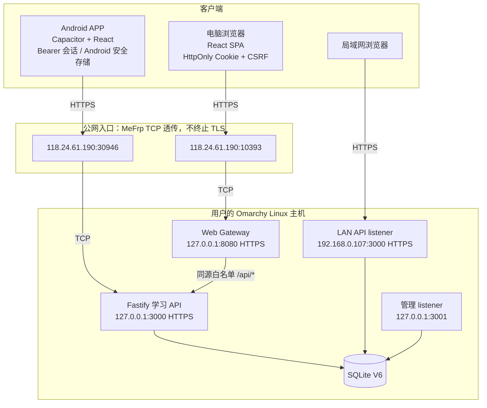

# 项目架构、形成过程与维护指南

更新时间：2026-10-23。本文区分已完成、正在验收和未开始事项；阶段状态以本地源码、验收记录和 `docs/ROADMAP.md` 为准。

## 项目是什么

理论考试练习系统是一套自托管的单机学习系统。维护者在自己的 Linux 主机运行业务服务、Web Gateway、管理入口和 SQLite；受邀用户通过 Android APP 或电脑网页练习。题库从本地 Excel 导入。数据不托管到公有云，普通用户不能自行注册。

它由三个互相配合的部分构成：

1. **客户端**：React + TypeScript 页面同时用于桌面 Web 和 Android。Vite 提供开发构建；Capacitor 将同一前端装入 Android WebView，并提供相机、网络状态、安全存储等原生插件。
2. **服务端**：Node.js + Fastify 提供业务 API 与独立本机管理 listener。所有判分、考试计时、题库版本和账号数据权限由服务端裁定。
3. **本地数据层**：SQLite 保存账号、题库、练习会话、收藏、错题复习轮次、模拟考试和成绩。数据库迁移按版本演进；生产部署前先备份并验证恢复。

## 系统架构


> 该图为 AI 生成的概念插画，不是现场网络截图；以下 Mermaid 图与地址表表示实际拓扑。



### 当前访问入口

| 用途 | 客户端地址 | 本机目标 | TLS 与访问边界 |
|---|---|---|---|
| Android API 公网 | `https://118.24.61.190:30946` | `127.0.0.1:3000` | TCP 隧道透传；API 证书由本机 CA 签发，IP SAN 校验，不允许明文回退 |
| Web 公网 | `https://118.24.61.190:10393` | `127.0.0.1:8080` | Web Gateway 本机终止 TLS；浏览器需单独信任 Web CA |
| Android API 局域网 | `https://192.168.0.107:3000` | `192.168.0.107:3000` | 当前 DHCP 地址，不保证重启后不变；证书需包含该 IP SAN |
| 管理界面与 API | 本机 loopback `127.0.0.1:3001` | `127.0.0.1:3001` | 不映射到 MeFrp，不通过公网 Web Gateway 代理 |

公网地址和端口采用现有 MeFrp TCP 隧道。TCP 节点只转发加密字节；证书验证发生在客户端到本机 HTTPS listener 之间。无域名、无 DDNS。普通浏览器不会读取 Android APK 的 CA 信任设置；每台需要访问 Web 的电脑必须另行信任 Web 私有 CA。当前 SAN 含公网 IP、已配置 LAN IP 和 loopback；LAN 地址尚未确认为固定租约。

### 请求流

**Android**：用户选定服务器地址 → 严格验证 HTTPS 证书链和 IP SAN → 调用 Fastify 学习 API → Bearer token 由 Android SecureStorage/进程内存持有 → Fastify 校验会话、用户和题库权限 → SQLite 事务写入答题、收藏、复习或考试状态。

**浏览器**：访问 Web Gateway → Gateway 提供带哈希文件名的生产 SPA → 浏览器调用当前站点 `/api/*` → Gateway 仅代理允许的学习 API 路径至 loopback Fastify → 浏览器使用 `HttpOnly; Secure; SameSite=Strict` Cookie 和 CSRF token → Fastify 返回数据。浏览器不把 Bearer token 存入 Web Storage。

**管理维护**：管理员在本机 loopback 管理 listener 使用单独的管理认证和管理路由。Gateway 与学习 listener 拒绝 `/admin`、`/api/admin/*`、bootstrap 和未知 API；管理端口不应出现在 frpc 配置中。

## 主要业务是如何实现的

### 账号与题库

- 账号由本机维护者建立；系统没有用户注册功能。
- 密码使用 Argon2id 哈希，服务端保存会话摘要；日志不输出密码、Token 或密码哈希。
- 首次登录可要求改密；重置密码或停用账号会撤销现有会话。
- Excel 采用“预览 → 确认”两步导入。原始题库文件仅作为本机输入，不能提交 Git。
- 当前正式题库来自本机批准的《四级理论试题.xlsx》：1,283 题（845 单选、38 多选、400 判断），缺少答案与阻止性格式错误为 0。重复题干按原始题库设计保留。
- 题目读取 API 不在作答前返回正确答案；归属校验以服务端 `user_id`、题库和版本为准。

### 练习与收藏

练习会话和题目顺序持久化，支持继续未完成会话。答题由服务端判分并以幂等键保护重试。收藏是服务端账号数据；收藏列表和收藏专项练习均读取实际 API。跨账号或切换题库后不能复用旧账号缓存。

### 模拟考试

四级默认考试规则：120 道单选×0.5 分、20 道多选×1 分、40 道判断×0.5 分，共 180 题、100 分、90 分钟。服务端创建固定题目和答案快照，裁定开始/截止时间、同步、超时和评分。答题请求携带版本及请求标识，以避免旧请求覆盖新答案；交卷可安全重试。未交卷前 API 和界面不暴露标准答案。用户退出或刷新后，仍可恢复服务器确认的答案。

### 错题复习

普通练习或考试答错会更新每用户/题目的错题状态。错题复习记录独立轮次和题目快照，支持题型、状态、数量组合及薄弱优先。掌握度只因**不同复习轮次**连续答对而推进：待复习 → 巩固中 → 已掌握；同轮重复提交不重复计数。历史轮次关联原题库版本，题库更新后仍可回看。

## SQLite 与备份

数据库版本：V6。项目从 V1 基础结构逐步增加账号首次改密字段、练习/考试持久化、考试答案版本与快照、错题复习轮次、Cookie CSRF token 和会话记住策略。V4 考试结构、V5 复习轮次和 V6 会话安全策略详见 `apps/server/src/db/migrations.ts` 与 `docs/ARCHITECTURE.md`。

备份工具使用 SQLite 一致性快照（`VACUUM INTO`），并检查 integrity 与 foreign keys；日备份轮换保留七个成功文件。正式迁移或恢复前必须建立并验证备份，隔离副本恢复演练通过后才能写生产库。不要直接复制运行中的 SQLite 主文件，也不要把数据库、WAL/SHM 或备份提交 Git。

## 安全边界

- 生产 Web/API 都使用 HTTPS 与 IP SAN；服务端私钥存于仓库外受限目录。
- Android 包中只有 CA **公开证书**，没有 CA 私钥；`usesCleartextTraffic=false`，网络安全策略只对明确 IP 信任该私有 CA。
- 浏览器 Web CA 和 Android API CA 分开管理。浏览器 CA 安装属于每个用户设备的信任操作；卸载时从相应信任存储移除。不能使用“忽略证书错误”、trust-all 或关闭主机名/IP 验证。
- CORS 使用明确 Origin allowlist；Cookie 写请求检查 CSRF token 和 Origin；`HttpOnly` 防止页面脚本读取会话 Cookie。
- Web Gateway 不代理管理路由，也不信任客户端伪造的 `Forwarded`、`X-Forwarded-*` 或 `X-Real-IP`。
- 管理 listener 保持 loopback；公网 MeFrp 仅映射学习 API 与 Web Gateway 的 HTTPS TCP 入口。
- 更新服务端验证 APK 缓存摘要；客户端核验 SHA-256、包身份和更高版本号。Debug 包不能冒充正式签名版本。
- 不公开仓库、不公开正式 Release、不将生产账号或题库凭据写入说明文档。

## 开发阶段如何形成

项目按可验收里程碑而非一次性大改推进。桌面首页和手机页面先确定信息层级与响应式骨架，再连接服务端，随后逐步增加持久化练习、账号与考试状态机、错题复习，最后补 Android、安全隔离和生产部署。每阶段都使用真实 SQLite/API 和浏览器/设备证据；开发夹具只在明确的开发预览里使用。

| 阶段 | 形成的能力 | 验收要点 |
|---|---|---|
| P0 | 项目骨架与桌面首页视觉基准 | React/Vite 启动、1536×1024 桌面布局、真实空状态 |
| P0-M | 手机 12 屏 | 390×844、360×800 页面与交互，不把效果图数据写死 |
| P1 | Fastify、SQLite、账号和 Excel 导入 | 安全哈希、管理员边界、预览/确认导入 |
| P2 | 日常练习、提交、收藏、进度 | 服务端判分、会话恢复、用户隔离 |
| P2-R | 账号发放和首登安全 | 强制改密、会话撤销、账号隔离 |
| P3 | 模拟考试 | 180/90/100 服务端状态机、同步、评分及历史 |
| P4 | 错题复习 | 独立复习轮次、薄弱优先、两轮掌握和历史快照 |
| P5-A | Android、会话/网络安全、双入口 | 原生扫码、安全存储、Cookie/CSRF、备份/更新完整性 |
| P5-B | 本机生产部署 | systemd、IP HTTPS、MeFrp TCP、V6 正式库与题库；Web 全站功能与视觉验收已完成并部署，P5-B 其余收尾仍在进行 |
| P6 | 整体发布准备 | 正式签名、最终 QA、安装升级和正式发布；未开始 |

APK 的 `dev.N` 逐包证据、修复和记录空缺见 [CHANGELOG.md](../CHANGELOG.md)。

## 本机开发与测试

```bash
npm --prefix apps/mobile install
npm --prefix apps/server install
npm --prefix apps/mobile run dev
npm --prefix apps/server run dev
```

项目依赖 Node.js 24+；Android 构建还需要 JDK 21 与 Android SDK。验证命令：

```bash
npm --prefix apps/mobile run typecheck
npm --prefix apps/mobile run build
npm --prefix apps/mobile run test
npm --prefix apps/server run typecheck
npm --prefix apps/server run build
npm --prefix apps/server test
npm --prefix apps/server run test:browser
npm --prefix apps/server run test:web:browser
```

### Android 私有 CA 构建输入

普通 Android 构建需要与服务端匹配的 API CA 公开证书。源码不包含此文件。Gradle 从 `THEORY_API_CA_FILE` 指定的仓库外路径读取证书；未设置时使用本机部署目录默认路径。资源只生成到被 Git 忽略的 `apps/mobile/android/app/src/main/res/raw/`。若本地已有资源与指定证书不一致，构建会停止且保留原文件，不自动覆盖。

```bash
THEORY_API_CA_FILE=/absolute/path/to/api-ca.pem \
  npm --prefix apps/mobile run android:debug
```

CA 私钥、服务器叶私钥、正式 SQLite、服务凭据均不能用来构建 APK，也不能放入 Git。测试用 CA 和生产 API CA 是不同用途，不要互换。

## 当前状态与限制

- P5-B 实际运行入口为 `https://118.24.61.190:30946`（Android API）和 `https://118.24.61.190:10393`（Web）；Android dev.10 已通过真实登录和练习，数据库 V6 已导入真实 1,283 题。
- Web 修复已部署到公网 Gateway/API。严格 CA Chromium 直接访问公网完成 16 个路由 × 6 种视口；公网健康为 200、未认证会话为 401、管理 API/页面为 404；没有横向溢出、未捕获 JavaScript 异常或意外 HTTP 错误。完整登录、会话恢复、练习判题、收藏增删与专项练习、错题两轮掌握、考试答题同步/恢复/交卷/复盘以及 A/B 账号切换，使用隔离 SQLite、真实 Excel 题库和 production Web Gateway HTTPS 构建验证，避免在正式账号写入验收数据。相关截图和部署回滚快照保存在 AI 产出目录 `报告与研究/理论考试练习系统/P5-B-Web验收-20261023/`。P5-B 阶段整体状态继续按路线图跟踪。
- LAN `192.168.0.107` 当前来自 DHCP，尚未确认静态租约；更换 LAN 地址需要同步证书 SAN 和 APK 网络策略。
- Android dev.10 是 Debug 签名测试包。正式 APK 签名连续性、完整应用内升级、正式 GitHub Release 和发布 QA 属 P6。
- 本项目的开发 APK `dev.1`–`dev.10` 不是连续的公开发行说明；没有逐个版本归档记录的构建明确标为“未留可核验证据”，不根据版本号推测 Bug 修复。
